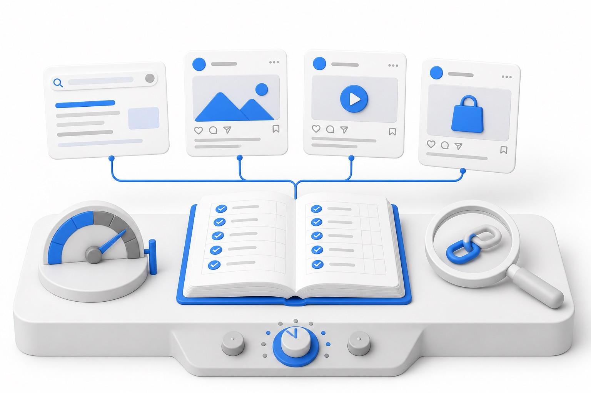
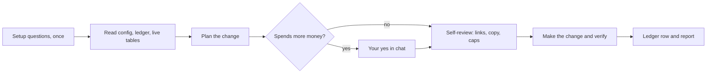

# ad-ops

<p align="center">
  
</p>

<p align="center">
  <b>Run your ad accounts end to end, with a ledger of every change</b>
</p>

<p align="center">
  
  
  
  <a href="https://maritime.sh"></a>
</p>

<p align="center"><sub>WORKS WITH</sub><br>
  
  
  
  
  
  
  
  
</p>

A Claude Code skill that runs your paid ad accounts once the creative exists.

It sets up campaigns, ad groups and ads on Google Ads, Meta (Facebook and Instagram), X and Reddit. It reviews what is live, edits copy, keywords, URLs and budgets, pauses, resumes and deletes. It checks every link and UTM, reads performance from your analytics and the platform UIs, and keeps a ledger of every change.

It asks its setup questions once, then does the job on its own and reports what it did. The only thing it asks you about is money: launching a paid campaign, raising a budget or bid, adding an account, or going past your caps. Pausing and lowering spend it does itself. Prefer to approve every change? Set `autonomy.mode: review`.

## Requirements

- [Claude Code](https://claude.com/claude-code).
- Python 3.9 or newer. The scripts use only the standard library. PyYAML is used if installed, but is not required.
- A browser automation tool for Claude (for example a Chrome extension or browser MCP) where you are already logged in to your ad accounts. The skill never logs in for you and never types passwords.
- Optional: an analytics tool. PostHog is the documented default; GA4 (BigQuery export) and Plausible are supported. With none, the skill falls back to platform numbers and says so.

## Install

```bash
git clone https://github.com/mariagorskikh/ad-ops ~/.claude/skills/ad-ops
```

For one project only, clone into `<project>/.claude/skills/ad-ops` instead.

## Configure

```bash
cd ~/.claude/skills/ad-ops
cp config.example.yaml config.yaml
```

Fill in:

- `brand`: your name, domain and default landing page.
- `platforms`: set `enabled` for each platform you use and add the account IDs.
- `utm`: the source names, mediums and macros. The defaults work for most teams.
- `analytics`: `posthog`, `ga4`, `plausible` or `none`, plus the conversion event you judge ads on.
- `budgets`: daily caps per platform and in total. The skill will not go past them without you raising the cap in chat.
- `ledger`: where the change ledger, launch plans and reviews live (CSV or JSONL).
- `autonomy`: `mode: autonomous` (default) or `mode: review`. Money always needs your yes.

You can also skip this step: on the first run the skill asks the setup questions in one batch and writes `config.yaml` for you.

Secrets stay in environment variables, never in the config. For `traffic_sql.py --run` on PostHog:

```bash
export POSTHOG_PROJECT_ID=12345
export POSTHOG_PERSONAL_API_KEY=...   # a personal API key with query read access
```

Use `AD_OPS_CONFIG=/path/to/config.yaml` to keep the config somewhere else, for example in a project repo.

Create the ledger:

```bash
python3 ~/.claude/skills/ad-ops/scripts/ledger.py init
```

## Example prompts

- "Set up the ads for the Spring Launch batch on Google and Meta."
- "Are the ads running?"
- "What is live right now?"
- "Pause the spring-hero-02 ad on Meta."
- "Change the Google budget to $15 a day."
- "Add these keywords to the Pricing ad group."
- "Fix the UTMs on the X posts."
- "Which ad is winning this week?"
- "How are the ads doing? Write the weekly review."

## How it works



1. **Asks once.** On the first run it asks for your domain, platforms, account IDs, analytics and budget caps in one batch, writes the config, and does not ask again unless a fact is truly missing.
2. **Reads first.** It loads the config, the ledger and the platform notes, then looks at the live platform tables.
3. **Only money waits for you.** A new paid campaign or ad set, any budget or bid increase, a new platform or account, and anything over your caps wait for your yes. A yes on a launch plan covers building all of it. Copy, keyword, URL and tracking edits, pauses, budget cuts, and resuming ads that already ran within their budget happen on their own. It deletes only when you ask.
4. **Checks its own work before acting.** URLs are built from your UTM scheme and fetched first: status 200, query intact, right domain, no stripped `?`. Copy is checked against your brand rules and the platform's limits.
5. **Verifies after saving.** It reloads and reads the table back, because ad UIs often show changes that never saved.
6. **Records everything.** Each change is one row in an append-only ledger, with the authority for it (self-review or your yes).
7. **Reports after.** One summary per run: every change, the exact copy and URLs that went live, what it skipped and why, and any money item waiting for you.
8. **Judges on real outcomes.** Reviews compare cost per conversion per creative from your own analytics, not platform clicks.

| What it does on its own | What it never does |
| --- | --- |
| Status checks, reviews, link and UTM fixes | Raise spend or launch a paid campaign without your yes |
| Copy and keyword edits, pauses, budget cuts | Log in, type passwords, or pass 2FA or CAPTCHAs |
| Resume ads that already ran, within budget | Touch billing or payment methods |
| Write the ledger and the weekly review | Accept platform recommendations or turn on auto-apply |
| Delete, when you ask for delete | Work around policy warnings or account limits |

## Safety and risks

- **Hard stops.** Re-auth, 2FA and CAPTCHA prompts, billing forms, policy warnings, account restrictions and limit notices stop that action. The skill finishes what else is safe and tells you.
- **Your caps are real.** The skill never goes past `budgets` without you raising them in chat.
- **Autonomous edits are still live edits.** A wrong keyword or a paused winner costs you reach. Every change is in the ledger so you can see and undo it. Use `mode: review` while you build trust.
- **Platform terms.** Ad platforms have their own rules about automated access to their web UIs. You are responsible for using this within each platform's terms.

## What's in the box

```
ad-ops/
  SKILL.md                 the skill: autonomy, stops, jobs, scripts
  config.example.yaml      copy to config.yaml and fill in
  references/
    accounts.md            where each platform lives, what to record
    browser.md             driving ad UIs from a browser tool without mis-clicks
    google.md              Google Ads click paths, settings, traps
    meta.md                Meta Ads Manager click paths, settings, traps
    x.md                   X Ads click paths and the stripped-link trap
    reddit.md              Reddit Ads, including the "user clicks, agent verifies" pattern
    tracking.md            UTM scheme, proof steps, failure modes, pixels and conversions
    review.md              daily health check, weekly review, decision rules, report template
  scripts/
    utm.py                 build tracked URLs from the config
    check_links.py         fetch landing URLs and flag broken or stripped tracking
    ledger.py              append-only change ledger (CSV or JSONL)
    traffic_sql.py         per-creative analytics queries (PostHog HogQL, GA4 BigQuery, Plausible)
    _config.py             config loader shared by the scripts
  assets/
    hero.jpg               README image
```

Platform click paths are accurate as of 2026. Ad UIs change often; when a step no longer matches, the skill adapts and you can update the reference file.

## Pairing with a creative skill

ad-ops does not write ads. If you have a skill or process that produces images, video and copy, set `creative.source_dir` to its output folder and `creative.copy_rules_file` to its brand rules. ad-ops reads those files and runs the accounts.

## Built by Maritime

<p align="center">
  <a href="https://maritime.sh">
    <picture>
      <source media="(prefers-color-scheme: dark)" srcset="assets/maritime-dark.png">
      
    </picture>
  </a>
</p>

This skill is open-sourced by [Maritime](https://maritime.sh) (YC F26), the cloud platform that gives every AI agent its own computer: sandboxes, agent boxes that keep their disk, and Linux desktops, Windows desktops and Android phones your agent can see and click. We run this skill ourselves.

Want ad-ops to run without your laptop open? A Maritime [computer](https://maritime.sh/docs/computers) gives the agent its own desktop and browser, signed in to your ad accounts once.

## More open-source skills from Maritime

- [talking-head-reel](https://github.com/mariagorskikh/talking-head-reel): turn a messy phone recording into an edited vertical reel
- [outreach-conductor](https://github.com/mariagorskikh/outreach-conductor): a weekly outbound cycle, researched and written in your voice
- [product-changelog](https://github.com/mariagorskikh/product-changelog): changelog email, social posts and video from what you shipped
- [linkedin-inbox-triage](https://github.com/mariagorskikh/linkedin-inbox-triage): find the real people in your LinkedIn inbox and answer them
- [slack-connect-onboarding](https://github.com/mariagorskikh/slack-connect-onboarding): shared Slack channels with customers, with a real welcome

## License

MIT. See [LICENSE](LICENSE).
